<div align="center">


# WMS

### Plataforma SaaS de Monitoreo y Gestión de Flotas Vehiculares

**Saber dónde está cada vehículo, en tiempo real, sin contratos largos ni hardware caro.**


**Proyecto Pedagógico Integrador (PPI)** · Ingeniería de Software II (PREINTIC25004)
Facultad de Ingeniería · Tecnológico de Antioquia – Institución Universitaria
Docente: **Jhon Hernández**

| Integrante | Rol SCRUM |
|---|---|
| Alejandro Mercado Quiroz | Product Owner |
| Duan Esteban Gómez Rojas | Scrum Master |
| José Sebastián González Cárdenas | Equipo de desarrollo (backend, GPS, alertas) |
| María José Lopera Velásquez | Equipo de desarrollo (frontend, usuarios, reportes, suscripciones) |

</div>

---

## Contenido

1. [El problema y la solución](#1-el-problema-y-la-solución)
2. [Capturas](#2-capturas)
3. [Características por módulo](#3-características-por-módulo)
4. [Arquitectura](#4-arquitectura)
5. [Estructura de carpetas](#5-estructura-de-carpetas)
6. [Puesta en marcha](#6-puesta-en-marcha)
7. [Guion de demostración (2 minutos)](#7-guion-de-demostración-2-minutos)
8. [API: endpoints](#8-api-endpoints)
9. [Scripts disponibles](#9-scripts-disponibles)
10. [Metodología SCRUM](#10-metodología-scrum)
11. [Matriz de cumplimiento de requisitos](#11-matriz-de-cumplimiento-de-requisitos)
12. [Calidad y pruebas](#12-calidad-y-pruebas)
13. [Despliegue en Azure y hoja de ruta](#13-despliegue-en-azure-y-hoja-de-ruta)
14. [Licencia y créditos](#14-licencia-y-créditos)

---

## 1. El problema y la solución

**Supermercados la 72**, una pequeña empresa de Medellín, perdió la motocicleta de su servicio de domicilios en un robo. No tenía ningún mecanismo de rastreo. El caso muestra un problema más amplio: las soluciones de monitoreo vehicular del mercado están pensadas para grandes flotas. Exigen contratos extensos, hardware costoso e implementaciones complejas, y dejan por fuera a las pymes con motos, carros y camiones mezclados.

**WMS** es una plataforma **SaaS multi-tenant** que cualquier pyme puede contratar por suscripción. Permite:

- 🗺️ ver la **ubicación en tiempo real** de la flota sobre OpenStreetMap, con movimiento fluido y estela de recorrido;
- ⬡ dibujar **geocercas** (círculos, polígonos y corredores de ruta) y recibir alertas de **entrada, salida y desvío**;
- 🚨 detectar automáticamente **paradas prolongadas**, **pérdida de señal del GPS**, **exceso de velocidad** y **movimiento con el encendido apagado (posible robo)**;
- 📄 generar **reportes PDF y Excel**, reproducir recorridos históricos y **compartirlos** por enlace;
- 👥 gestionar **usuarios, roles y permisos granulares**, conductores, dispositivos GPS, plan y facturación.

Todo con una interfaz inspirada en las apps de Apple: materiales translúcidos, tipografía SF, modo claro y oscuro, animaciones con curva de resorte, *bottom sheet* y *tab bar* en el celular.

---

## 2. Capturas

> Se generan con `npm run screenshots` (Playwright) mientras corre `npm run dev`. Ver [scripts/screenshots.mjs](scripts/screenshots.mjs).

| Mapa en vivo | Mapa en vivo (oscuro) |
|---|---|
| 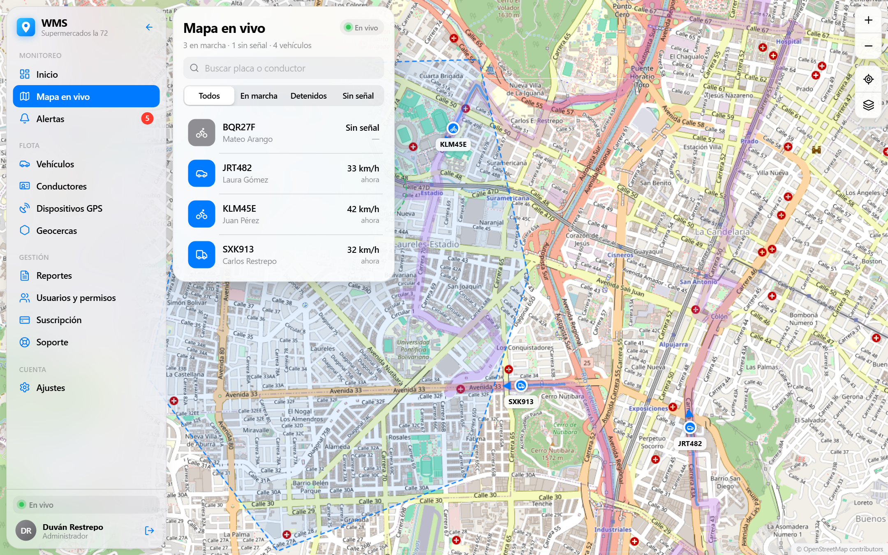 | 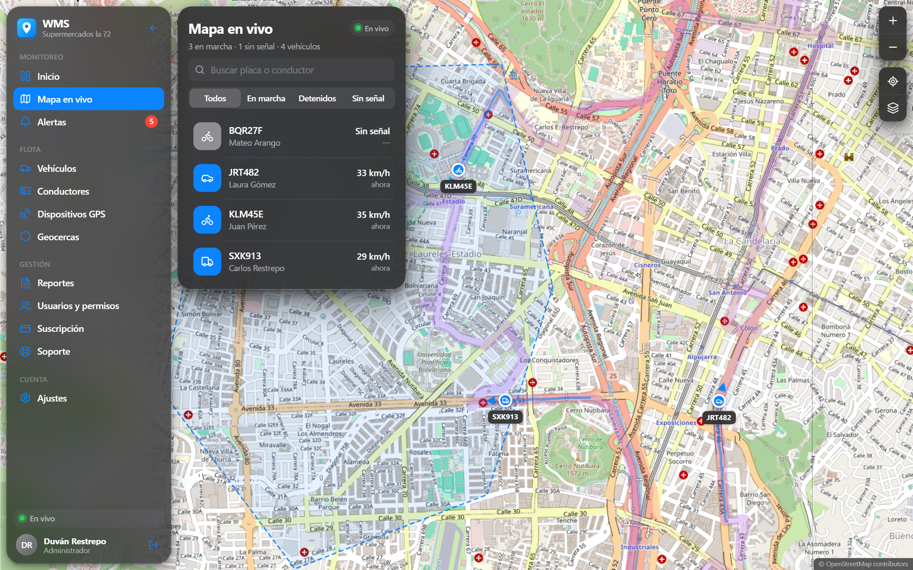 |

| Dashboard | Inicio de sesión |
|---|---|
| 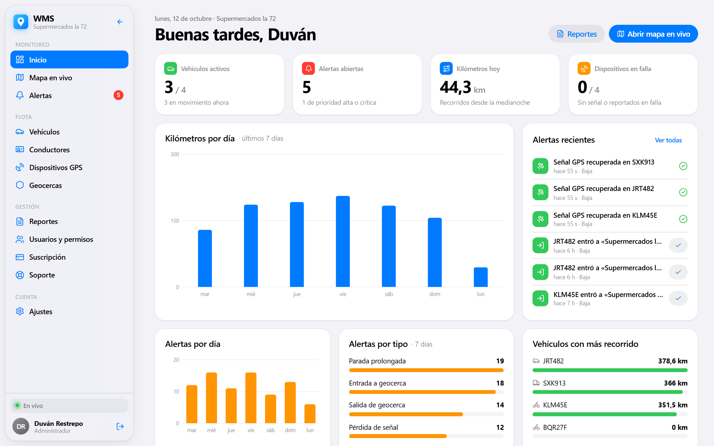 | 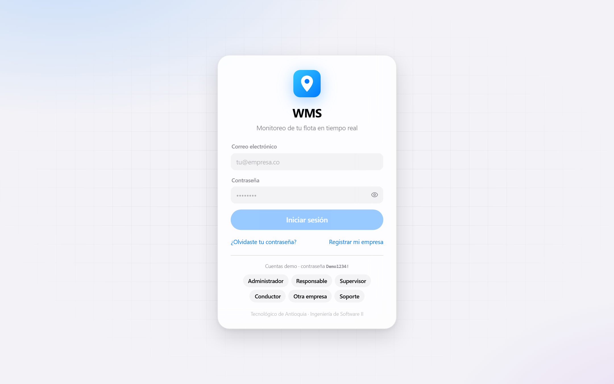 |

| Geocercas | Alertas |
|---|---|
| 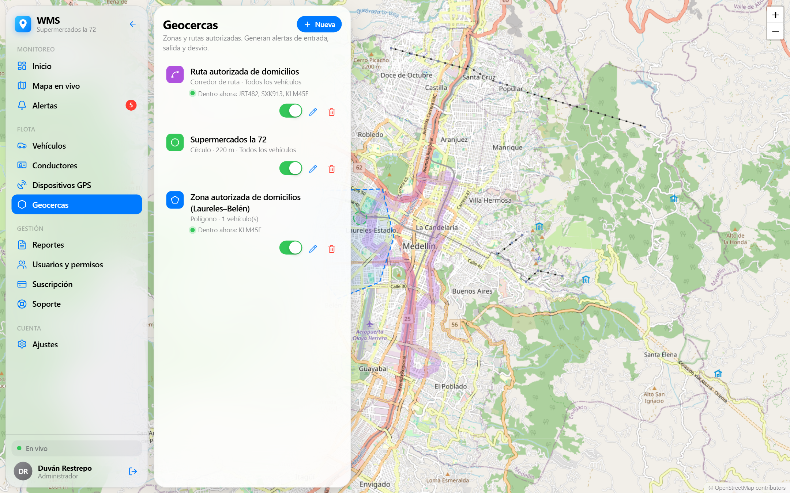 | 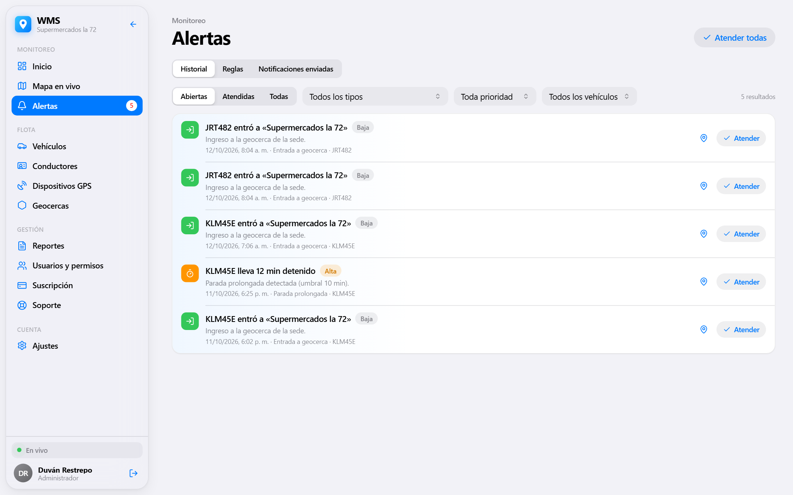 |

| Reportes | Vehículos |
|---|---|
| 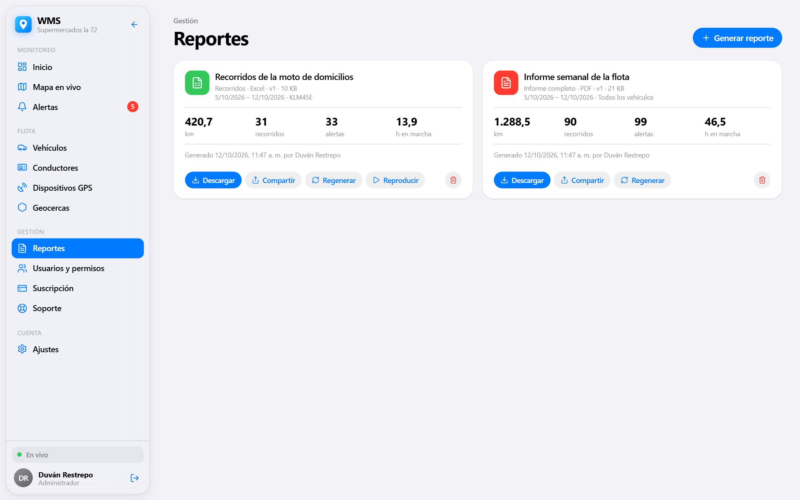 | 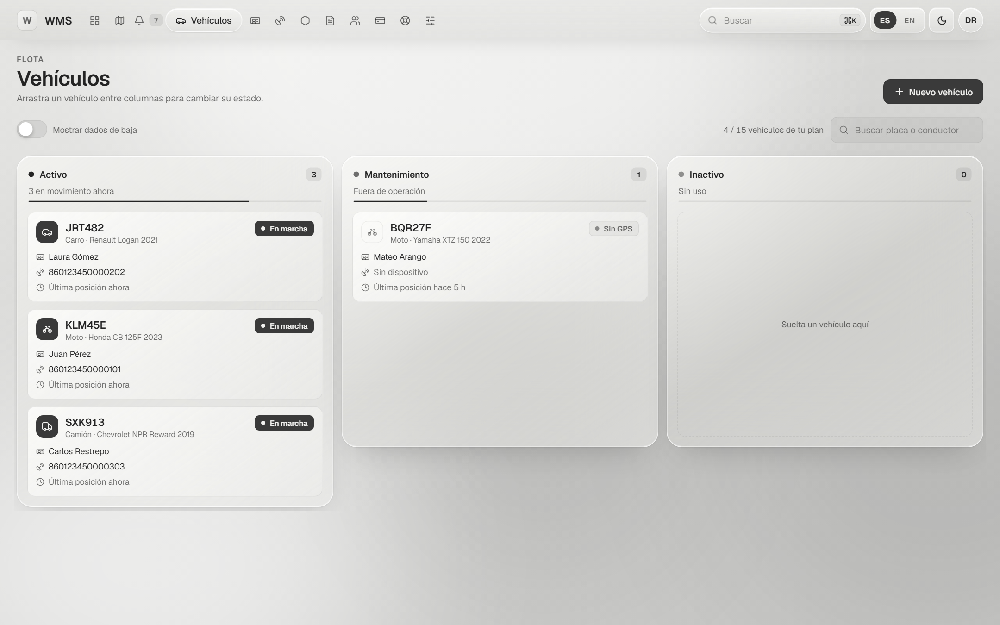 |

| Móvil: mapa con *bottom sheet* | Móvil: alertas con *tab bar* |
|---|---|
| 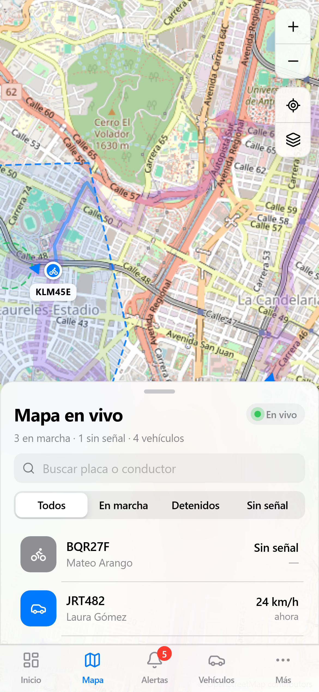 | 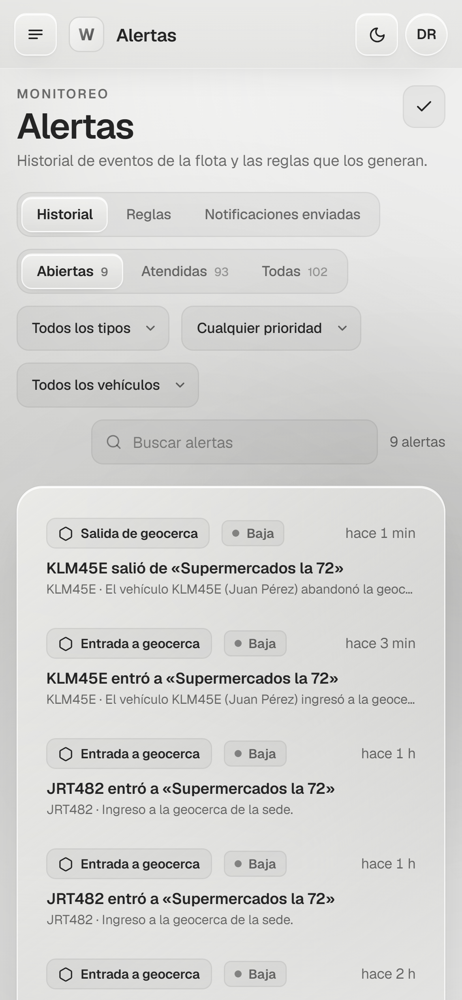 |

---

## 3. Características por módulo

| Módulo | Qué hace | Requisitos |
|---|---|---|
| **Mapa en vivo** (HU1) | Mapa de OpenStreetMap centrado en Medellín y limitado al Valle de Aburrá. Marcador estilo Apple Maps (punto azul, halo pulsante, cono de rumbo, placa), **animación interpolada a 60 fps** y estela de los últimos 10 min. Tarjeta del vehículo con velocidad, batería del GPS, conexión, encendido y conductor. Botón «Seguir», selector de capas (OSM, CARTO Positron y Dark Matter, automático según el tema), filtros y búsqueda. En el celular el panel es un *bottom sheet* arrastrable con 3 alturas. | RG2, RE1, RF2, RE10 |
| **Dashboard** | KPIs: vehículos activos, alertas abiertas, km del día y dispositivos en falla. Gráficas de km y alertas por día, alertas por tipo, vehículos con más recorrido y alertas recientes que se pueden atender ahí mismo. | RG5 |
| **Vehículos** | CRUD con placa colombiana validada, tipo (moto, carro, camión, furgón), estado, GPS y conductor. Baja con motivo, que conserva el histórico. **Reproducción de recorridos** con línea de tiempo. Respeta el límite de vehículos del plan. | RF1-RF4, RG6 |
| **Conductores** | Registro (conductor = usuario con rol `driver` + perfil con licencia), asignación 1:1 a vehículos y estado. | RE7 |
| **Mi turno** (rol conductor) | Iniciar y finalizar recorrido, y **botón de emergencia** con ubicación. | Modelo de dominio |
| **Dispositivos GPS** | Registro independiente del vehículo con API key, estado (activo, inactivo, en falla), conexión y batería en vivo, reasignación y baja (robado, dañado, fin de vida útil). | RF28-RF31, RG8 |
| **Geocercas** | Dibujo sobre el mapa de **círculo** (centro y radio), **polígono** (vértices arrastrables) y **corredor de ruta** (polilínea y ancho). Asociación a vehículos, colores, activar o desactivar, y borrado lógico. Muestra qué vehículos están dentro en este momento. | RE2, RF5-RF8, RG3 |
| **Alertas** | Reglas configurables (tipo, umbral, geocerca, vehículos, canales, destinatarios y prioridad). Historial con filtros y paginación, marcar como atendida y **bandeja de correos y push enviados (simulados)**. Toast tipo notificación de iOS, badge rojo y sonido opcional. | RG4, RE3-RE5, RF15-RF18 |
| **Reportes** | PDF (KPIs, mini-mapa vectorial del recorrido y tablas) y Excel (una hoja por sección, con filtros) por vehículo, conductor y periodo. Historial, **regenerar** (con versión), eliminar y **compartir** por enlace con token y vencimiento o por envío directo a otro usuario. | RG5, RE6, RF19-RF22, RF33 |
| **Usuarios y permisos** | CRUD de usuarios, roles (Responsable, Administrador, Supervisor, Conductor) y una **matriz de permisos por módulo** (sin acceso, lectura o escritura) que sobrescribe la del rol. Restablecer contraseña. | RG9, RF9-RF12, RF32 |
| **Suscripción y facturación** | Plan actual, uso frente a límites, comparativo de planes (Básico, Pro, Flota en COP), cambio de plan, cancelación y reactivación, facturas con IVA y pago simulado, y datos de la empresa. | RG7, RE9, RF23-RF26 |
| **Registro de empresa** | Alta *self-service* en 3 pasos: plan, empresa y responsable. | RF23, HU7 |
| **Soporte** | Tickets con hilo tipo iMessage. El Agente de Soporte de WMS atiende tickets de todas las empresas. | Actor «Agente de soporte» |
| **Ajustes** | Perfil, cambio de contraseña, tema (automático, claro u oscuro), sonido y **panel del simulador GPS** (pausar, velocidad x1-x4 y escenarios). | RF27 |

---

## 4. Arquitectura

### 4.1 Componentes

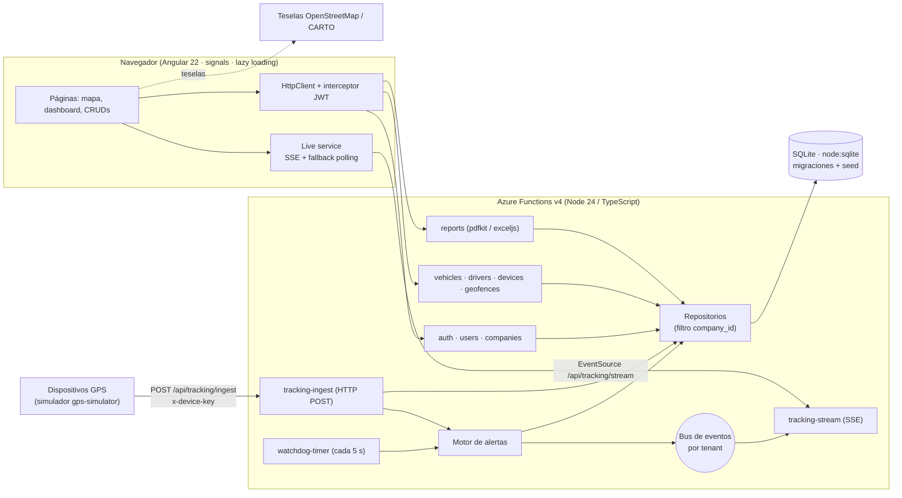

**Decisiones clave**

- **Un solo código de funciones, dos formas de ejecutarlo.** Cada función se declara una vez con `defineHttp`, `defineStream` o `defineTimer` ([api/src/shared/http.ts](api/src/shared/http.ts)). Dentro del host de Azure se registra con `app.http` o `app.timer` del modelo v4. Con `npm run dev`, un **adaptador Express** ([api/src/local/server.ts](api/src/local/server.ts)) monta exactamente las mismas funciones en `http://localhost:7071/api`, así el proyecto arranca sin instalar Azure Functions Core Tools.
- **Persistencia sin servidores.** Usa `node:sqlite`, el SQLite integrado en Node 22.13+ y 24, así que no hay compilación nativa. Tiene migraciones versionadas y una capa de repositorios: migrar a Azure SQL o Cosmos DB solo exige reemplazar `shared/db.ts` y `shared/repositories/`.
- **Aislamiento multi-tenant obligatorio.** El `tenantId` sale del JWT y todos los métodos de los repositorios lo reciben como primer parámetro. Un recurso de otra empresa responde **404**, no 403, para no revelar que existe. Los dispositivos GPS se autentican con su propia API key, y el tenant se deduce del dispositivo, nunca del payload.
- **Tiempo real.** SSE con reconexión y renovación del token. Si falla 3 veces, pasa a polling cada 2 s.

### 4.2 Flujo GPS → ingest → alertas → stream → mapa

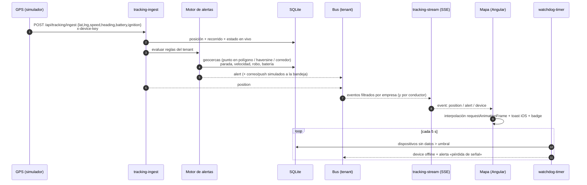

### 4.3 Modelo de datos (ER)

```mermaid
erDiagram
  PLANS ||--o{ SUBSCRIPTIONS : "contratado en"
  COMPANIES ||--o{ SUBSCRIPTIONS : tiene
  COMPANIES ||--o{ INVOICES : factura
  COMPANIES ||--o{ USERS : emplea
  USERS ||--o| DRIVER_PROFILES : "es conductor"
  COMPANIES ||--o{ DEVICES : posee
  COMPANIES ||--o{ VEHICLES : posee
  DEVICES |o--o| VEHICLES : "instalado en"
  USERS |o--o{ VEHICLES : conduce
  VEHICLES ||--o{ TRIPS : realiza
  TRIPS ||--o{ POSITIONS : "se compone de"
  VEHICLES ||--o| VEHICLE_LIVE : "última posición"
  COMPANIES ||--o{ GEOFENCES : define
  GEOFENCES }o--o{ VEHICLES : "aplica a"
  COMPANIES ||--o{ ALERT_RULES : configura
  ALERT_RULES ||--o{ ALERTS : genera
  ALERTS ||--o{ NOTIFICATIONS : "se envía por"
  COMPANIES ||--o{ REPORTS : genera
  REPORTS ||--o{ REPORT_SHARES : "se comparte"
  COMPANIES ||--o{ TICKETS : abre
  TICKETS ||--o{ TICKET_COMMENTS : contiene

  USERS { text id PK; text company_id FK; text email; text password_hash; text role; json permissions; bool active }
  DEVICES { text id PK; text serial; text model; text api_key; text status; text connection; int battery; text last_seen_at }
  VEHICLES { text id PK; text plate; text type; text status; text device_id FK; text driver_id FK }
  POSITIONS { int id PK; text vehicle_id; text trip_id; real lat; real lng; real speed; real heading; real accuracy; text ts }
  TRIPS { text id PK; text started_at; text ended_at; real distance_m; real max_speed }
  GEOFENCES { text id PK; text shape; real center_lat; real center_lng; real radius_m; json coordinates }
  ALERT_RULES { text id PK; text type; real threshold; text geofence_id; json channels; json recipients; text priority }
  ALERTS { text id PK; text type; text priority; text title; real lat; real lng; bool attended }
  REPORTS { text id PK; text type; text format; blob content; int version }
```

El detalle de cada requisito frente al código y las pruebas está en **[docs/traceability.md](docs/traceability.md)**.

---

## 5. Estructura de carpetas

```
wms/
├─ apps/web/                     # Angular 22 (standalone, signals, zoneless, lazy loading)
│  └─ src/app/
│     ├─ core/                   # api, auth (JWT + refresh + guards), live (SSE), formatos es-CO
│     ├─ ui/                     # design system: sheet, segmented, toggle, toasts, alertas, gráficas, íconos
│     ├─ layout/                 # shell: sidebar translúcida / tab bar móvil
│     └─ features/               # auth, dashboard, map, vehicles, drivers, devices, geofences,
│                                #   alerts, reports, users, billing, support, settings, driver
├─ api/                          # Azure Functions v4 (Node/TypeScript)
│  ├─ src/functions/
│  │  ├─ auth/  users/  vehicles/  drivers/  devices/  geofences/  alerts/
│  │  ├─ reports/                # builder PDF (pdfkit) y Excel (exceljs)
│  │  ├─ companies/  support/
│  │  ├─ tracking-ingest/        # POST de posiciones (RE1)
│  │  ├─ tracking-stream/        # SSE + polling + snapshot + dashboard
│  │  ├─ watchdog-timer/         # timer: pérdida de señal y paradas (RE4, RE5)
│  │  └─ gps-simulator/          # motor, flota, control, ruta estática route-medellin.geojson
│  ├─ src/shared/                # db, migraciones, auth, permisos, http, zod, geo, motor de alertas, repositorios
│  ├─ src/local/server.ts        # adaptador Express (npm run dev)
│  ├─ test/                      # vitest + supertest (unitarias, multi-tenant, alertas, E2E)
│  └─ host.json, local.settings.json
├─ scripts/                      # seed.ts, build-route.ts, ensure-db.ts, screenshots.mjs
├─ docs/                         # traceability.md, screenshots/
├─ docker-compose.yml
└─ README.md
```

---

## 6. Puesta en marcha

### 6.1 Requisitos previos

| Herramienta | Versión | ¿Obligatoria? |
|---|---|---|
| [Node.js](https://nodejs.org) LTS | **22.13 o superior** (probado con 24.16) | ✅ Sí. Incluye `node:sqlite`. |
| npm | 10+ | ✅ Sí |
| Git | cualquiera | Para clonar |
| [Azure Functions Core Tools](https://learn.microsoft.com/azure/azure-functions/functions-run-local) | 4.x | ❌ Opcional (`npm run dev:func`) |
| [Azurite](https://learn.microsoft.com/azure/storage/common/storage-use-azurite) | 3.x | ❌ Solo si usas `func` (el timer lo necesita) |
| Docker | 24+ | ❌ Opcional |

> No se necesita ninguna base de datos ni servicio externo: SQLite va embebido y el GPS se simula.

### 6.2 Paso a paso

```bash
# 1. Clonar
git clone <url-del-repositorio> wms
cd wms

# 2. Instalar dependencias (monorepo con npm workspaces: api + web)
npm install

# 3. (Opcional) variables de entorno: todo tiene valores por defecto para la demo
cp .env.example .env

# 4. (Opcional) crear o reiniciar los datos demo. `npm run dev` lo hace solo la primera vez.
npm run seed

# 5. Levantar todo: API + simulador GPS + frontend
npm run dev
```

| Servicio | URL |
|---|---|
| 🌐 Aplicación web | **http://localhost:4200** |
| ⚙️ API (adaptador Azure Functions) | http://localhost:7071/api (salud: `/api/health`) |
| 🛰️ Simulador GPS | proceso en consola (`[sim]`) que envía 4 vehículos cada segundo |

### 6.3 Credenciales demo

Contraseña para todas: **`Demo1234!`**. También puedes usar los botones de «Cuentas demo» en la pantalla de inicio de sesión.

| Correo | Rol | Empresa | Para probar |
|---|---|---|---|
| `admin@la72.co` | Administrador | Supermercados la 72 (Pro) | Todo, salvo cambiar el plan |
| `gerencia@la72.co` | Responsable de empresa | Supermercados la 72 | Suscripción, cambio y cancelación de plan |
| `supervisor@la72.co` | Supervisor | Supermercados la 72 | Monitoreo, alertas, reportes (usuarios solo lectura: permiso granular) |
| `conductor@la72.co` | Conductor | Supermercados la 72 | «Mi turno», botón de emergencia, solo ve su moto |
| `admin@eltrigal.co` | Responsable | Panadería El Trigal (Básico) | **Aislamiento multi-tenant**: solo ve su furgón |
| `soporte@wms.co` | Agente de soporte | WMS (plataforma) | Tickets de todas las empresas |

### 6.4 Ejecutar con Azure Functions Core Tools (opcional)

```bash
npm run dev:azurite   # en otra terminal: emulador de Storage (Azurite) para el timer
npm run dev:func                               # compila y ejecuta `func start` en el puerto 7071
npm run dev:sim                                # simulador GPS
npm run dev:web                                # frontend
```

### 6.5 Docker (opcional)

```bash
docker compose up
```

### 6.6 Solución de problemas

| Síntoma | Solución |
|---|---|
| `EADDRINUSE :7071` o `:4200` | Otro proceso usa el puerto. Ciérralo, o cambia `PORT` en `.env` y el `target` de `apps/web/proxy.conf.json`. |
| El mapa no muestra vehículos moviéndose | Revisa que la consola muestre `[sim] 🛰️ Simulador GPS conectado`. En **Ajustes › Simulador GPS** debe decir «Simulador conectado» y no estar en pausa. |
| `npm run seed` falla con «No se pudo borrar …wms.db» (Windows) | La API tiene la base abierta: detén `npm run dev` y vuelve a ejecutar el seed. |
| `node:sqlite` no existe | Tu Node es anterior a 22.13: actualiza a la LTS actual. |
| El mapa aparece gris | No hay internet para descargar las teselas de OpenStreetMap: la app sigue funcionando y las teselas cargan al volver la conexión. |
| «Tu sesión expiró» | Los tokens de acceso duran 15 min y se renuevan solos. Si el refresh token fue revocado (logout o cambio de contraseña), inicia sesión de nuevo. |
| `func start`: «listener for watchdog-timer was unable to start» | Falta Azurite (ver 6.4). Las funciones HTTP siguen funcionando. |
| Las alertas de demo tardan | En modo demo, la parada prolongada salta a los 25 s y la pérdida de señal a los 20 s. Con `DEMO_MODE=false`, el seed usa 10 min y 3 min. |

---

## 7. Guion de demostración (2 minutos)

1. **Login** (0:00): entra como `admin@la72.co` con el botón «Administrador». Muestra el **dashboard**: KPIs, km por día y alertas recientes.
2. **Mapa en vivo** (0:20): 3 vehículos de la 72 recorren siempre la misma ruta real por Medellín (Poblado → San Antonio → Berrío → U. de A. → Estadio → **Carrera 72** → Laureles → Av. 33 → Regional). Toca la moto **KLM45E**: tarjeta con velocidad, batería y conductor, y el toggle «Seguir». Muestra las capas (OSM, claro y oscuro).
3. **Escenario: parada prolongada** (0:45): en **Ajustes › Simulador GPS**, moto **KLM45E** → «Parada prolongada». Vuelve al mapa: el marcador se pone naranja y a los 25 s aparece el **toast «KLM45E lleva 25 s detenido»**, sube el badge rojo de Alertas y se registran el correo y el push en **Alertas › Notificaciones enviadas**.
4. **Escenario: robo** (1:10): «Simular robo» sobre el camión o la moto. Se mueve con el encendido apagado y se sale del corredor: **alerta crítica** y desvío de ruta.
5. **Geocercas** (1:25): dibuja un círculo nuevo sobre el mapa y guárdalo.
6. **Reporte** (1:40): **Reportes › Generar** → «Informe completo», PDF, 7 días. Descárgalo y pulsa **Compartir** para copiar el enlace público. Ábrelo en una ventana privada.
7. **Cierre** (1:55): inicia sesión como `admin@eltrigal.co` para mostrar el **aislamiento multi-tenant**.

---

## 8. API: endpoints

Base: `/api`. Respuestas de error con forma uniforme `{ code, message, details }` (`400 VALIDATION_ERROR`, `401`, `402 PLAN_LIMIT`, `403`, `404`, `409`, `429`). Autenticación con `Authorization: Bearer <JWT>`. El SSE acepta `?access_token=` porque `EventSource` no envía cabeceras.

| Método | Ruta | Permiso | RF |
|---|---|---|---|
| POST | `/auth/login` | público (rate limit) | RF13 |
| POST | `/auth/refresh` · `/auth/logout` | público | RF14 |
| GET / PATCH | `/auth/me` | sesión | — |
| POST | `/auth/change-password` | sesión | RF27 |
| POST | `/auth/forgot-password` · `/auth/reset-password` | público | RF27 |
| GET | `/users` · `/users/{id}` | users:read | RF10 |
| POST | `/users` | users:write | RF9 |
| PATCH | `/users/{id}` | users:write | RF11 |
| PUT | `/users/{id}/permissions` | users:write | RF32 |
| POST | `/users/{id}/reset-password` | users:write | RF27 |
| DELETE | `/users/{id}` | users:write | RF12 |
| GET | `/meta/permissions` · `/meta/alert-types` | sesión | — |
| GET | `/vehicles` · `/vehicles/{id}` | vehicles:read | RF2 |
| POST | `/vehicles` | vehicles:write | RF1 |
| PATCH | `/vehicles/{id}` | vehicles:write | RF3 |
| DELETE | `/vehicles/{id}?reason=` | vehicles:write | RF4 |
| GET | `/vehicles/{id}/positions` · `/vehicles/{id}/trips` · `/trips/{id}/positions` | vehicles:read | RF2 (playback) |
| GET / POST | `/drivers` | drivers:read / write | RE7 |
| GET / PATCH / DELETE | `/drivers/{id}` | drivers | RE7 |
| PUT | `/drivers/{id}/vehicle` | drivers:write | RE7 |
| GET | `/me/driver` | rol conductor | — |
| POST | `/me/trip/start` · `/me/trip/finish` · `/me/emergency` | rol conductor | Dominio |
| GET | `/devices` · `/devices/{id}` | devices:read | RF29 |
| POST | `/devices` | devices:write | RF28 |
| PATCH | `/devices/{id}` | devices:write | RF30 |
| POST | `/devices/{id}/regenerate-key` | devices:write | RF28 |
| DELETE | `/devices/{id}?reason=robado\|dañado\|fin_vida_util\|otro` | devices:write | RF31 |
| GET | `/geofences` · `/geofences/{id}` | geofences:read | RF6 |
| POST | `/geofences` | geofences:write | RF5 |
| PATCH | `/geofences/{id}` | geofences:write | RF7 |
| DELETE | `/geofences/{id}` (lógico) | geofences:write | RF8 |
| GET | `/alert-rules` | alerts:read | — |
| POST | `/alert-rules` | alerts:write | RF15 |
| PATCH | `/alert-rules/{id}` | alerts:write | RF17 |
| DELETE | `/alert-rules/{id}` | alerts:write | RF18 |
| GET | `/alerts?type&priority&vehicleId&attended&from&to&limit&offset` | alerts:read | RF16 |
| POST | `/alerts/{id}/attend` · `/alerts/attend-all` | alerts:write | RF16 |
| GET | `/notifications` | alerts:read | RE3 |
| GET | `/reports` · `/reports/{id}` | reports:read | RF20 |
| POST | `/reports` | reports:write | RF19 |
| POST | `/reports/{id}/regenerate` | reports:write | RF21 |
| GET | `/reports/{id}/download` | reports:read | RE6 |
| DELETE | `/reports/{id}` | reports:write | RF22 |
| POST | `/reports/{id}/share` · GET `/reports/{id}/shares` · DELETE `/report-shares/{id}` | reports | RF33 |
| GET | `/reports-shared` (compartidos conmigo) | sesión | RF33 |
| GET | `/public/reports/{token}` · `/public/reports/{token}/download` | público (token) | RF33 |
| GET | `/plans` | público | RE9 |
| POST | `/companies/signup` | público | RF23 |
| GET / PATCH | `/company` | billing | RE9 |
| GET | `/subscription` | billing:read | RF24 |
| PUT | `/subscription/plan` | billing:write | RF25 |
| POST | `/subscription/cancel` | billing:write | RF26 |
| GET | `/invoices` · POST `/invoices/{id}/pay` | billing | RE9 |
| GET / POST | `/tickets` · GET / PATCH `/tickets/{id}` · POST `/tickets/{id}/comments` | support | Soporte |
| POST | `/tracking/ingest` (cabecera `x-device-key`) | dispositivo | RE1, RG8 |
| GET | `/tracking/live` · `/tracking/poll?since=` | map:read | RE1 |
| GET | `/tracking/stream` (SSE) | map:read | RG2 |
| GET | `/dashboard` | dashboard:read | RG5 |
| GET / PATCH | `/simulator/state` · POST `/simulator/scenarios` | simulator | Demo |
| GET | `/simulator/control` · POST `/simulator/heartbeat` | clave del simulador | Demo |
| ⏱ timer | `watchdog-timer` (`*/5 * * * * *`) | — | RE4, RE5 |

**Ejemplo: así reporta un GPS real.**

```http
POST /api/tracking/ingest
Content-Type: application/json
x-device-key: gps_xxxxxxxxxxxxxxxx

{ "lat": 6.2530, "lng": -75.5920, "speed": 32.5, "heading": 120, "battery": 88,
  "accuracy": 5, "ignition": true, "timestamp": "2026-10-12T15:04:05Z" }
```

---

## 9. Scripts disponibles

| Script | Qué hace |
|---|---|
| `npm run dev` | Crea la BD demo si no existe y levanta **API + simulador + web** con `concurrently`. |
| `npm run dev:api` · `dev:sim` · `dev:web` | Cada proceso por separado. |
| `npm run dev:func` | Compila y ejecuta las funciones con Azure Functions Core Tools. |
| `npm run seed` | Borra y recrea la base demo: 2 empresas, 10 usuarios, 7 días de historial y reportes. |
| `npm run build-route` | Consulta **una vez** OSRM y guarda la ruta en `route-medellin.geojson` (`-- --force` para regenerar). |
| `npm run build` | Compila la API (`tsc`) y la web (`ng build`, producción). |
| `npm test` | Pruebas de la API (vitest + supertest) y del frontend (vitest de Angular). |
| `npm run lint` | ESLint (typescript-eslint) en todo el monorepo. |
| `npm run format` | Prettier. |
| `npm run screenshots` | Capturas del README con Playwright (`-- --dark`, `-- --mobile`, `-- --only=mapa`). |

---

## 10. Metodología SCRUM

SCRUM permite entregar incrementos cortos que se validan con el cliente real (Supermercados la 72) sprint a sprint. Con 4 integrantes, aporta una estructura ligera de roles y ceremonias: *sprint planning*, *daily*, *review* y retrospectiva.

### Product backlog

| # | Historia de usuario | Requisitos | Prioridad | Estado |
|---|---|---|---|---|
| **HU1** | Ver en un mapa la ubicación en tiempo real de mis vehículos | RG2, RE1, RF2 | Muy alta | ✅ |
| HU2 | Registrar, consultar, actualizar y eliminar vehículos | RG6, RF1-RF4 | Muy alta | ✅ |
| HU3 | Crear geocercas y recibir notificaciones de entrada/salida | RG3, RE2, RE3, RF5-RF8 | Alta | ✅ |
| HU4 | Alertas automáticas de paradas prolongadas y fallos del GPS | RG4, RE4, RE5, RF15-RF18 | Alta | ✅ |
| HU5 | Usuarios con roles e inicio y cierre de sesión seguros | RG9, RG10, RF9-RF14 | Alta | ✅ |
| HU6 | Generar y exportar reportes históricos | RG5, RE6, RF19-RF22 | Media | ✅ |
| HU7 | Registrarme y gestionar mi plan y facturación | RG1, RG7, RE8, RE9, RF23-RF26 | Media | ✅ |
| HU8 | Registrar y asociar conductores a vehículos | RE7 | Media | ✅ |
| HU9 | Usar la plataforma desde celular, tablet o computador | RG1, RE10 | Baja-Media | ✅ |

### Sprint backlog: HU1 (monitoreo en tiempo real)

| Tarea | Responsable | Implementación |
|---|---|---|
| [Backend] Arquitectura de comunicación GPS → servidor (HTTP, JSON) | José Sebastián | `tracking-ingest` + API key por dispositivo |
| [Backend] Modelo de datos de ubicación y vehículos (multi-tenant) | Duan Gómez | `positions`, `vehicle_live`, `trips` (migración v1) |
| [Backend] Endpoint de recepción de datos GPS | María José Lopera | `POST /api/tracking/ingest` |
| [Backend] Servicio de consulta de última ubicación | José Sebastián | `GET /api/tracking/live`, `GET /api/vehicles/{id}` |
| [Frontend] Mapa interactivo (Leaflet), responsive | Duan Gómez | `features/map` (panel de vidrio + *bottom sheet*) |
| [Frontend] Actualización en tiempo real | María José Lopera | `Live` service: SSE + polling |
| [Backend] Autenticación y aislamiento por empresa | José Sebastián | JWT + filtro `company_id` |
| [Pruebas] Flujo completo GPS → mapa | Alejandro Mercado | `api/test/alerts-e2e.test.ts` |
| [Pruebas] Usabilidad con usuario no técnico | Alejandro Mercado | Guion de demostración (§7) |

---

## 11. Matriz de cumplimiento de requisitos

**Requisitos generales:** RG1 ✅ · RG2 ✅ · RG3 ✅ · RG4 ✅ · RG5 ✅ · RG6 ✅ · RG7 ✅ · RG8 ✅ (simulado; contrato HTTP listo para equipos reales) · RG9 ✅ · RG10 ✅

**Requisitos específicos:** RE1 ✅ · RE2 ✅ · RE3 ✅ (en plataforma; correo y push **simulados** en bandeja) · RE4 ✅ · RE5 ✅ · RE6 ✅ · RE7 ✅ · RE8 ✅ · RE9 ✅ (pago **simulado**) · RE10 ✅

**Requisitos funcionales:**

| Usuarios | Vehículos | Geocercas | Alertas | Reportes | GPS | Suscripción |
|---|---|---|---|---|---|---|
| RF9 ✅ RF10 ✅ RF11 ✅ RF12 ✅ RF13 ✅ RF14 ✅ RF27 ✅ RF32 ✅ | RF1 ✅ RF2 ✅ RF3 ✅ RF4 ✅ | RF5 ✅ RF6 ✅ RF7 ✅ RF8 ✅ | RF15 ✅ RF16 ✅ RF17 ✅ RF18 ✅ | RF19 ✅ RF20 ✅ RF21 ✅ RF22 ✅ RF33 ✅ | RF28 ✅ RF29 ✅ RF30 ✅ RF31 ✅ | RF23 ✅ RF24 ✅ RF25 ✅ RF26 ✅ |

Detalle de cada requisito (endpoint, pantalla y prueba) en [docs/traceability.md](docs/traceability.md).

**Lo que se simula, y cómo sería en producción:**

| Aspecto | En el PPI | En producción |
|---|---|---|
| Dispositivo GPS | Proceso `gps-simulator` con la misma API HTTP | Equipos Teltonika, Queclink o Coban que reportan por HTTP o con un *gateway* TCP → HTTP |
| Correo / push | Bandeja «Notificaciones enviadas» y log estructurado | SendGrid / Azure Communication Services, Azure Notification Hubs |
| Pasarela de pago | Botón «Pagar» simulado | Wompi / PayU / Mercado Pago |
| Desvío y robo | Trazos rectos fuera de la ruta | Datos reales del GPS |

---

## 12. Calidad y pruebas

```bash
npm test          # 32 pruebas de API + 5 del frontend
npm run lint      # ESLint sin errores
npm run build     # build de producción (bundle inicial ≈ 110 kB gzip)
```

| Archivo | Cubre |
|---|---|
| `api/test/geo.test.ts` | Haversine, punto en círculo, polígono (incl. cóncavo) y corredor de ruta |
| `api/test/auth-tenant.test.ts` | Login, rate limit, refresh rotativo, logout, zod, cambio de contraseña, roles, permisos granulares, **aislamiento multi-tenant** (listado, 404 cruzado, dispositivos ajenos), límites del plan y registro de empresa |
| `api/test/alerts-e2e.test.ts` | Ingesta GPS (API key, validación), entrada/salida de geocerca, parada prolongada (una sola alerta), pérdida y recuperación de señal (watchdog), robo, desvío, CRUD de reglas, **E2E GPS → SSE → mapa** (incl. que otra empresa no recibe el evento), PDF/Excel válidos, regenerar, compartir y eliminar |
| `apps/web/src/**/*.spec.ts` | Formatos COP y zona Bogotá, gráfica de barras accesible |

Las pruebas usan una base SQLite temporal por archivo con el mismo seed de la demo.

---

## 13. Despliegue en Azure y hoja de ruta

**Despliegue sugerido**

1. **Azure Static Web Apps** para `apps/web` (`npm run build -w apps/web` → `dist/web/browser`), con una regla de *fallback* a `index.html`.
2. **Azure Functions** (plan Flex Consumption, Node 24) para `api`: `npm run build -w api` y `func azure functionapp publish <app>`. Configura `JWT_SECRET`, `JWT_REFRESH_SECRET`, `CORS_ORIGIN` y `DEMO_MODE=false` en *App settings*.
3. **Datos:** reemplaza `shared/db.ts` y `repositories/` por Azure SQL o Cosmos DB. El SQLite local no es apto para varias instancias.
4. **Tiempo real a escala:** sustituye el bus en memoria por **Azure Web PubSub o SignalR Service**, porque las instancias de Functions no comparten memoria.
5. **Ingesta masiva:** IoT Hub o Event Hubs delante de `tracking-ingest`.

**Hoja de ruta:** app móvil del conductor (PWA con GPS del teléfono), integración con GPS físicos por TCP, mantenimiento preventivo por kilometraje, rutas óptimas de domicilios, geocercas por horario, facturación electrónica DIAN y pasarela de pagos real.

---

## 14. Licencia y créditos

Código bajo licencia **MIT** con fines académicos. © 2026 Duan Esteban Gómez Rojas, José Sebastián González Cárdenas, María José Lopera Velásquez y Alejandro Mercado Quiroz.

- Datos de mapas © **colaboradores de [OpenStreetMap](https://www.openstreetmap.org/copyright)**, licencia ODbL. Las teselas estándar se usan según la [política de uso de teselas de OSM](https://operations.osmfoundation.org/policies/tiles/), sin descargas masivas.
- Teselas claras y oscuras © [CARTO](https://carto.com/attributions).
- Ruta demo calculada **una sola vez** con [OSRM](https://project-osrm.org/) y guardada como archivo estático.
- Íconos [Lucide](https://lucide.dev) (ISC). Mapas con [Leaflet](https://leafletjs.com) (BSD-2).
- «Supermercados la 72» se usa como caso de estudio del PPI. Los datos de la demo son ficticios.
# WMS
