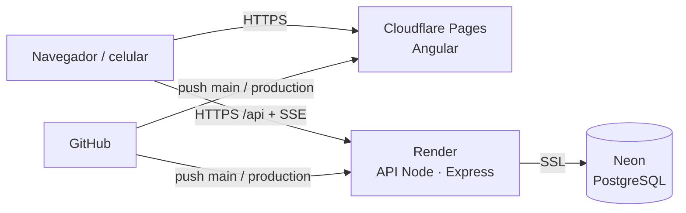

# Despliegue en la nube: laboratorio y producción

WMS corre en la nube en **dos ambientes**, con el mismo código y bases de datos separadas:

| | Laboratorio (`lab`) | Producción (`production`) |
|---|---|---|
| Para qué sirve | Probar cambios y mostrar la plataforma con datos | Uso real: guarda todo lo que se registra |
| Datos al arrancar | Datos demo (2 empresas, flota, 7 días de historial) | **Ninguno**: solo el catálogo de planes |
| Simulador GPS | Sí, dentro del servidor (cada 5 s) | No |
| Cuentas demo (`Demo1234!`) | Sí, y se ven en el login | No existen |
| Rama de Git | `main` | `production` |
| Frontend | Cloudflare Pages · proyecto `wms-flota-lab` | Cloudflare Pages · proyecto `wms-flota` |
| API | Render · `wms-api-lab` | Render · `wms-api-prod` |
| Base de datos | Neon (PostgreSQL) · `wms_lab` | Neon (PostgreSQL) · `wms_prod` |

La demo de GitHub Pages (<https://duangomez.github.io/WMS/>) sigue igual: todo corre en el navegador, sin servidor.

Los tres sitios (demo, laboratorio y producción) se publican con **el mismo build de Angular** y los mismos ajustes de rendimiento de [scripts/pages/](../scripts/pages/) (versión liviana para equipos de gama baja, táctil, precargas). Solo cambia `window.__WMS_CFG` en `index.html`.



## Cómo se promueve un cambio

1. Se trabaja en `main` → GitHub Actions corre lint y pruebas (SQLite y PostgreSQL) y publica el **laboratorio**.
2. Cuando el laboratorio está bien, se lleva a producción: `git checkout production && git merge main && git push`.
3. Render y Cloudflare publican **producción** solos. Las migraciones de la base se aplican al arrancar la API.

## Configuración inicial (una sola vez)

### 1. Neon (base de datos)

1. Crear una cuenta en <https://neon.tech> y un proyecto en la región **AWS US East (N. Virginia)** (la misma de Render).
2. Crear dos bases: `wms_lab` y `wms_prod` (*Databases › New database*).
3. Copiar la *connection string* **pooled** de cada una (`postgresql://…-pooler…/wms_lab?sslmode=require`).

### 2. Render (API)

1. Crear una cuenta en <https://render.com> y conectar GitHub.
2. *New › Blueprint* → elegir el repositorio `WMS`: Render lee [`render.yaml`](../render.yaml) y crea los dos servicios.
3. Completar las variables que pide:
   - `DATABASE_URL`: la URL de Neon de cada ambiente.
   - `CORS_ORIGIN`: la dirección del frontend de ese ambiente (paso 3), p. ej.
     `https://wms-flota-lab.pages.dev,https://*.wms-flota-lab.pages.dev`.
   - Producción (opcional): `SUPPORT_EMAIL` y `SUPPORT_PASSWORD` para la cuenta de soporte de la plataforma.
   - `JWT_SECRET`, `JWT_REFRESH_SECRET` y `SIMULATOR_KEY` los genera Render.
4. Verificar: `https://wms-api-lab.onrender.com/api/health` debe responder `{"status":"ok","env":"lab","db":"postgres"…}`.

### 3. Cloudflare Pages (frontend)

1. Crear un *API token* en Cloudflare con el permiso **Cloudflare Pages: Edit** y copiar el **Account ID**.
2. En GitHub › *Settings › Secrets and variables › Actions*:
   - Secretos: `CLOUDFLARE_API_TOKEN`, `CLOUDFLARE_ACCOUNT_ID`.
   - Variables: `LAB_API_URL` (`https://wms-api-lab.onrender.com`), `PROD_API_URL` (`https://wms-api-prod.onrender.com`).
3. El flujo [`cloud.yml`](../.github/workflows/cloud.yml) crea los proyectos de Pages la primera vez y publica en cada push.

## Antes de una exposición

- Render (plan gratuito) **apaga la API tras 15 min sin visitas** y tarda ~1 min en despertar. Una hora antes:
  GitHub › *Actions › Mantener la API despierta › Run workflow* (p. ej. 3 horas, ambiente `production`).
- En producción: registrar la empresa en `/registro` (plan **Flota**: hasta 60 usuarios), entrar a
  **Conductores › Invitar con QR**, crear la invitación y pulsar **Proyectar QR**.
- Cada asistente escanea el código, crea su cuenta de conductor y, al permitir la ubicación, aparece en el **Mapa en
  vivo** justo donde está. La ubicación del navegador requiere HTTPS (Cloudflare lo da) y el permiso del celular.

## Ejecutar los ambientes en tu equipo

```bash
# Laboratorio local sobre PostgreSQL en memoria (PGlite), con datos demo y simulador dentro del servidor
APP_ENV=lab DATABASE_URL=pglite:memory JWT_SECRET=… JWT_REFRESH_SECRET=… SIMULATOR_KEY=… npm start -w api

# Pruebas de la API contra PostgreSQL (las mismas que corren en CI)
WMS_TEST_DB=postgres npm run test:api

# Build del frontend de un ambiente
WMS_ENV=lab WMS_API_URL=https://wms-api-lab.onrender.com node scripts/build-cloud.mjs
```

## Variables de entorno de la API

| Variable | Para qué |
|---|---|
| `APP_ENV` | `local` (por defecto), `lab` o `production` |
| `DATABASE_URL` | PostgreSQL (Neon). Vacía = SQLite local (`DB_PATH`) |
| `CORS_ORIGIN` | Orígenes del frontend separados por coma; acepta `https://*.dominio` |
| `JWT_SECRET`, `JWT_REFRESH_SECRET`, `SIMULATOR_KEY` | Obligatorias en la nube (≥ 24 caracteres) |
| `SUPPORT_EMAIL`, `SUPPORT_PASSWORD` | Cuenta de soporte de la plataforma (se crea sola si no existe) |
| `SIMULATOR_STEP_SECONDS` | Laboratorio: cada cuántos segundos avanza el simulador (5) |
| `POSITIONS_RETENTION_DAYS` | Borra posiciones GPS más antiguas (lab: 10; producción: 0 = conservar) |
| `DATABASE_POOL_MAX` | Conexiones simultáneas a PostgreSQL (8) |
