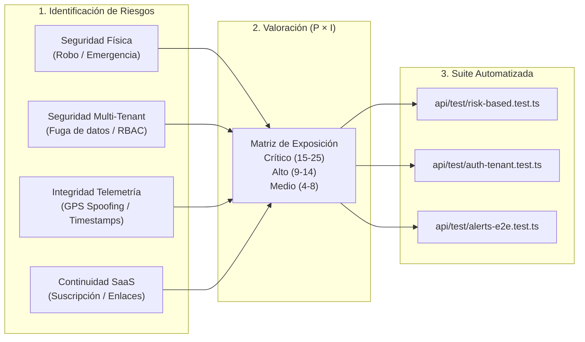

# Plan e Informe de Pruebas Basadas en Riesgo (RBT) · WMS

**Proyecto Pedagógico Integrador (PPI)** · Ingeniería de Software II (`PREINTIC25004`)  
**Plataforma:** WMS – Plataforma SaaS de Monitoreo y Gestión de Flotas Vehiculares  
**Estándar de referencia:** ISO/IEC/IEEE 29119 (Risk-Based Testing) & OWASP Top 10 SaaS/API  

---

## 1. Metodología de Evaluación de Riesgos

En las **Pruebas Basadas en Riesgo (Risk-Based Testing — RBT)** el esfuerzo de verificación y validación se prioriza calculando la **Exposición al Riesgo ($ER$)**:

$$ER = P \times I$$

Donde:
- **Probabilidad ($P \in [1..5]$):** Frecuencia o facilidad técnica de que ocurra el defecto o ataque (complejidad ciclomática, exposición pública del endpoint, concurrencia en tiempo real).
- **Impacto ($I \in [1..5]$):** Consecuencia en el negocio del cliente (*Supermercados la 72* y pymes suscritas) si el fallo llega a producción (robo de vehículo no detectado, fuga de datos entre empresas, indisponibilidad del rastreo).

---

## 2. Matriz de Riesgos de Calidad del Software

| ID | Categoría | Descripción del Riesgo | Módulo / Componente | $P$ (1-5) | $I$ (1-5) | $ER = P \times I$ | Nivel | Prueba Asociada |
|---|---|---|---|---|---|---|---|---|
| **R-01** | Seguridad Física / Dominio | **Falso negativo o silenciamiento en alerta de robo (`theft`) o botón de pánico:** un vehículo es remolcado/movido con `ignition: false` o el conductor pulsa emergencia, pero la alerta crítica no se dispara o no se rearma tras encender el vehículo. | [`alert-engine.ts`](file:///C:/Users/23429/.gemini/antigravity/scratch/WMS/api/src/shared/alert-engine.ts), [`drivers/index.ts`](file:///C:/Users/23429/.gemini/antigravity/scratch/WMS/api/src/functions/drivers/index.ts) | 4 | 5 | **20** | 🔴 **Crítico** | `CP-R01`, `CP-R02` |
| **R-02** | Seguridad SaaS / Multi-Tenant | **Fuga de datos entre empresas (IDOR / SSE) o escalamiento de privilegios:** que un usuario acceda a vehículos/alertas de otro tenant o se auto-asigne permisos de administrador (`users:write`, `billing:write`). | [`auth.ts`](file:///C:/Users/23429/.gemini/antigravity/scratch/WMS/api/src/shared/auth.ts), [`users/index.ts`](file:///C:/Users/23429/.gemini/antigravity/scratch/WMS/api/src/functions/users/index.ts) | 4 | 5 | **20** | 🔴 **Crítico** | `CP-R02`, `CP-R04` |
| **R-03** | Seguridad IoT / Telemetría | **Inyección de coordenadas con dispositivo GPS robado, inactivo o clave rotada:** un GPS dado de baja por robo sigue enviando ubicaciones falsas para desviar la búsqueda policial. | [`tracking-ingest`](file:///C:/Users/23429/.gemini/antigravity/scratch/WMS/api/src/functions/tracking-ingest/index.ts), [`devices/index.ts`](file:///C:/Users/23429/.gemini/antigravity/scratch/WMS/api/src/functions/devices/index.ts) | 4 | 5 | **20** | 🔴 **Crítico** | `CP-R03` |
| **R-04** | Negocio / Facturación SaaS | **Operación sin suscripción activa:** una empresa con suscripción `canceled` continúa registrando vehículos o modificando reglas sin reactivar su plan. | [`auth.ts`](file:///C:/Users/23429/.gemini/antigravity/scratch/WMS/api/src/shared/auth.ts#L109-L117), [`companies/index.ts`](file:///C:/Users/23429/.gemini/antigravity/scratch/WMS/api/src/functions/companies/index.ts) | 3 | 4 | **12** | 🟠 **Alto** | `CP-R05` |
| **R-05** | Integridad de Datos GPS | **Anomalías temporales (Time-Spoofing / reloj GPS desincronizado):** paquetes GPS con `timestamp` en el futuro o pasado lejano que distorsionan cálculo de velocidad, paradas prolongadas o distancias de recorridos. | [`ingest.ts`](file:///C:/Users/23429/.gemini/antigravity/scratch/WMS/api/src/shared/ingest.ts#L54-L95) | 4 | 3 | **12** | 🟠 **Alto** | `CP-R07` |
| **R-06** | Privacidad / Exposición de Información | **Acceso a reportes mediante enlaces públicos expirados:** un enlace compartido (`/api/public/reports/{token}`) sigue permitiendo ver o descargar el PDF/Excel tras vencer su vigencia. | [`reports/index.ts`](file:///C:/Users/23429/.gemini/antigravity/scratch/WMS/api/src/functions/reports/index.ts#L387-L428) | 3 | 4 | **12** | 🟠 **Alto** | `CP-R06` |
| **R-07** | Precisión Geoespacial | **Falsos positivos en bordes de geocercas cóncavas y corredores:** errores de redondeo en fórmula de Haversine o Ray-Casting sobre el Valle de Aburrá. | [`geo.ts`](file:///C:/Users/23429/.gemini/antigravity/scratch/WMS/api/src/shared/geo.ts) | 3 | 3 | **9** | 🟡 **Medio** | `geo.test.ts` |

---

## 3. Especificación de Casos de Prueba Basados en Riesgo

Todos los casos de prueba están automatizados en [`api/test/risk-based.test.ts`](file:///C:/Users/23429/.gemini/antigravity/scratch/WMS/api/test/risk-based.test.ts).

### CP-R01 · Persistencia y rearme de alerta crítica de robo (`R-01`, `RG4`)
- **Objetivo:** Garantizar que el motor de alertas detecte movimiento sin encendido (`ignition: false, speed > 5`), no sature de alertas duplicadas si el vehículo robado se detiene temporalmente en un semáforo (`speed: 0, ignition: false`), y rearme la regla únicamente cuando el vehículo vuelve a encenderse legítimamente (`ignition: true`).
- **Precondiciones:** Vehículo activo con dispositivo GPS en línea y regla `theft` activa.
- **Pasos de ejecución:**
  1. Enviar `POST /api/tracking/ingest` con `{ speed: 35, ignition: false }` → Verifica creación de 1 alerta `theft` (`priority: 'critical'`).
  2. Enviar `{ speed: 0, ignition: false }` seguido de `{ speed: 40, ignition: false }` → Verifica que el contador de alertas no aumente (evita tormenta de alertas durante el mismo incidente).
  3. Enviar `{ speed: 20, ignition: true }` → El motor limpia el estado `firing`.
  4. Enviar `{ speed: 38, ignition: false }` → Verifica que se dispare una segunda alerta crítica.

### CP-R02 · Botón de emergencia del conductor y aislamiento Multi-Tenant (`R-01`, `R-02`)
- **Objetivo:** Validar que el conductor en turno pueda emitir una alerta de pánico con la ubicación más reciente de su celular y que ningún otro tenant tenga visibilidad sobre la emergencia.
- **Pasos de ejecución:**
  1. El conductor (`conductor@la72.co`) reporta coordenadas con `POST /api/me/location`.
  2. Activa `POST /api/me/emergency` con mensaje descriptivo.
  3. Se comprueba que la alerta tenga `priority: 'critical'`, tome las coordenadas frescas del celular y sea visible para `admin@la72.co`, pero invisible (`0` resultados) para `admin@eltrigal.co`.

### CP-R03 · Revocación de credenciales GPS por inactividad, rotación o baja por robo (`R-03`, `RF28`, `RF31`)
- **Objetivo:** Impedir que un dispositivo GPS inactivo, con clave rotada o dado de baja por robo pueda inyectar posiciones en la plataforma.
- **Pasos de ejecución:**
  1. Crear GPS con `status: 'inactive'` e intentar `POST /api/tracking/ingest` → Debe responder `403 Forbidden`.
  2. Activar GPS (`PATCH /api/devices/{id}`) → Responde `202 Accepted`.
  3. Rotar clave (`POST /api/devices/{id}/regenerate-key`) e intentar ingesta con la clave anterior → Responde `401 Unauthorized`.
  4. Dar de baja el dispositivo con `DELETE /api/devices/{id}?reason=robado` e intentar ingesta con la nueva clave → Responde `401 Unauthorized`.

### CP-R04 · Prevención de escalamiento horizontal y vertical de privilegios (`R-02`, `RG9`, `RF32`)
- **Objetivo:** Verificar que un usuario con rol `supervisor` o `driver` no pueda modificar sus propios permisos granulares ni elevar su rol a `admin`.
- **Pasos de ejecución:**
  1. Autenticar como `supervisor@la72.co` e invocar `PUT /api/users/{id}/permissions` solicitando `users: 'write'` y `billing: 'write'` → Debe responder `403 Forbidden`.
  2. Autenticar como `conductor@la72.co` e invocar `PATCH /api/users/{id}` con `{ role: 'admin' }` → Debe responder `403 Forbidden`.

### CP-R05 · Bloqueo de escritura por suscripción cancelada y reactivación (`R-04`, `RG7`, `RF25`, `RF26`)
- **Objetivo:** Asegurar el cumplimiento del modelo de negocio SaaS: una suscripción cancelada bloquea operaciones de escritura (`POST/PATCH/DELETE`) en módulos operativos, conserva acceso de lectura (`GET`) y permite la reactivación en `billing`.
- **Pasos de ejecución:**
  1. Registrar empresa nueva y cancelar su suscripción (`POST /api/subscription/cancel`).
  2. Intentar registrar un vehículo (`POST /api/vehicles`) → Responde `403 Forbidden`.
  3. Consultar vehículos (`GET /api/vehicles`) → Responde `200 OK`.
  4. Reactivar plan (`PUT /api/subscription/plan`) y crear vehículo → Responde `201 Created`.

### CP-R06 · Caducidad de enlaces públicos de reportes (`R-06`, `RF33`)
- **Objetivo:** Garantizar que los enlaces públicos compartidos (`/api/public/reports/{token}`) rechacen tanto la consulta de metadatos como la descarga binaria una vez superado `expires_at`.
- **Pasos de ejecución:**
  1. Generar reporte PDF y crear enlace compartido (`POST /api/reports/{id}/share`).
  2. Expirar el registro `expires_at` e invocar `GET /api/public/reports/{token}` y `/download` → Ambos deben responder `400 Bad Request` indicando que el enlace expiró.

### CP-R07 · Resiliencia ante timestamps GPS fuera de ventana (`R-05`, `RE1`)
- **Objetivo:** Confirmar que timestamps manipulados o provenientes de relojes GPS desconfigurados ($> 10\text{ min}$ de desfase respecto al servidor) sean reemplazados por el timestamp del servidor para no corromper recorridos ni paradas prolongadas.
- **Pasos de ejecución:**
  1. Enviar posición con `timestamp` adelantado $+3\text{ horas}$ en el futuro.
  2. Comprobar que la posición se almacena con la hora actual del servidor (`±1 s`).
